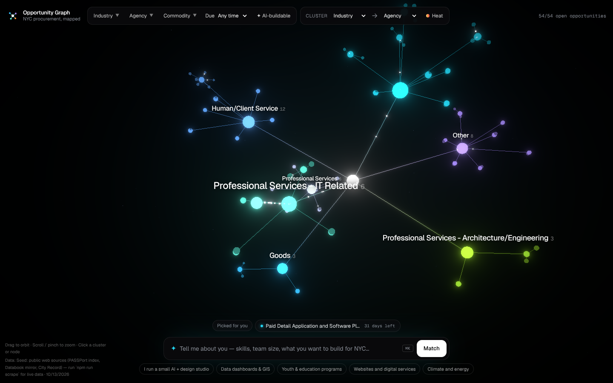

# Opportunity Graph (NYC)



A 3D, motion-designed way to explore NYC procurement opportunities from [PASSPort](https://passport.cityofnewyork.us/page.aspx/en/rfp/request_browse_public), get matched to the ones that fit you, and draft a response.

- **Proposal:** [`docs/PROPOSAL.md`](docs/PROPOSAL.md) restates the brief, with the decisions and stack
- **Roadmap / task list:** [`docs/ROADMAP.md`](docs/ROADMAP.md) gives the phases, validation gates and build order
- **Rankings:** [`docs/RANKINGS.md`](docs/RANKINGS.md) lists open solicitations ranked by AI-buildable fit and by value
- **Research:** [`docs/RESEARCH.md`](docs/RESEARCH.md) surveys libraries and repos, plus Vercel's guidelines
- **Brand:** [`docs/BRAND.md`](docs/BRAND.md)

## Run it

```bash
git clone -b claude/nyc-passport-rfp-viz-98fi1c https://github.com/lesx22/nyc-rfp.git
cd nyc-rfp/app
npm install
npm run dev          # http://localhost:5173
npm run build        # typecheck + production build
npm run test:smoke   # Playwright: desktop + mobile core flow, no console errors
```

### Refresh the data from live PASSPort

```bash
cd nyc-rfp/app
npx playwright install chromium    # one-time
HEADED=1 npm run scrape            # visible browser; drop HEADED=1 to run headless
node --experimental-strip-types scripts/rankings.ts   # regenerate docs/RANKINGS.md
git add public/data/rfps.json ../docs/RANKINGS.md && git commit -m "Live PASSPort scrape" && git push
```

The scraper hasn't been run against the live site yet (the cloud build environment can't reach it). If it writes 0 rows, share the `Columns seen:` line it prints.

## What's in v0

- A WebGL "neural network" (three.js + react-three-fiber) with bloom, idle orbit, travelling pulses, drag-to-orbit and trackpad zoom
- A hierarchy of Industry → Agency → solicitation, remappable live (Agency → Industry, Commodity…)
- A prompt bar ("tell me about you") that rotates the graph to your matches and re-highlights them
- Click a cluster for stats and a ranked list; click a node for details, an explained AI-fit score and a PASSPort link
- Filters for industry, agency, commodity, due window and AI-buildable status, plus a deadline-heat toggle
- Response Studio: brief → about you → documents → outline (.md) → submission checklist
- Runs entirely in the frontend; data is static JSON

## Data note

The current dataset is a **54-row seed** collected from public, search-indexed copies of PASSPort, the Databook mirror and City Record, because this build environment's network policy blocks `passport.cityofnewyork.us`. Inferred fields are flagged in the data and in the UI. Run `npm run scrape` from a normal network to load the full live grid.
